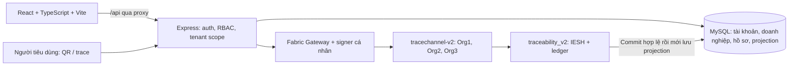

# TraceChain — bàn giao bản demo ổn định

Nghiệm thu ngày **09/11/2026, Asia/Bangkok** trên Windows/WSL2 + Docker Desktop hiện có. Mục tiêu là đồ án nhỏ có thể demo và kiểm chứng, không triển khai thêm email, Redis, Kafka, Kubernetes hoặc dịch vụ enterprise.

## 1. Kết quả và bằng chứng

- Frontend: **http://localhost:3001**; backend: **http://localhost:8080**; MySQL host: **127.0.0.1:3307**.
- Docker Engine 29.8.2; frontend/backend/MySQL healthy, restart count 0 ở snapshot nghiệm thu cuối.
- Fabric peer v3.1.5; ba MSP Org1MSP/Org2MSP/Org3MSP cùng channel `tracechannel-v2`.
- Chaincode `traceability_v2`, version **4.3**, sequence **6**, cả ba org đã approve. Không nâng cấp chaincode hay đổi mạng trong lượt này.
- Endorsement `/Channel/Application/Endorsement`, policy **MAJORITY** của 3 org; IESH là kiểm tra nghiệp vụ riêng, không đồng nhất với endorsement.
- **P1 cấu hình còn mở:** DEMO_PASSWORD hiện không khớp password các staff demo cũ; chưa reset vì phải giữ credential hiện có. Xem mục 9 và [smoke thực tế](../reports/delivery-live-smoke.json). Không coi bản demo đã sẵn sàng đăng nhập bằng DEMO_PASSWORD cho đến khi xử lý lựa chọn này.
- Bài E2E API và luồng trình duyệt đều ghi đủ **11 sự kiện thật**, kết thúc `READY_FOR_SALE`, đọc lại lịch sử từ Fabric và kiểm chứng IESH hợp lệ.

Bằng chứng có timestamp và không chứa mật khẩu/token/private key:

| Tài liệu | Nội dung |
| --- | --- |
| [delivery-e2e.json](../reports/delivery-e2e.json) | 11 transaction ID, trạng thái từng bước, COMMITTED_VALID được API giám sát kiểm tra, ca từ chối, seed và reconnect |
| [delivery-browser.json](../reports/delivery-browser.json) | Một lô khác được thao tác qua frontend bằng bốn vai trò, đủ 11 event, truy xuất public sau logout, native validation và viewport mobile |
| [delivery-runtime.json](../reports/delivery-runtime.json) | Snapshot 3 peer/config/policy; fingerprint toàn bộ bảng trước restart và bằng chứng persistence |
| [delivery-runtime-current.json](../reports/delivery-runtime-current.json) | Snapshot chỉ đọc sau ổn định: health cuối, network, lifecycle và không có lot QA trong database ứng dụng |
| [ACCOUNT_HIERARCHY](./ACCOUNT_HIERARCHY.md) | Kiến trúc tài khoản, invitation, RBAC, migration 007, signer và giới hạn bảo mật |

Snapshot persistence lấy ngay sau restart có thể ghi Docker health `starting` trong khi HTTP đã sẵn sàng. Snapshot `runtime-current` là kiểm tra sau khi `up --wait` đã hoàn tất; phân biệt hai thời điểm này.

## 2. Khảo sát và lỗi đã sửa

Đã đọc [AGENTS.md](../AGENTS.md), mã nguồn liên quan và hai PDF đề cương/báo cáo giữa kỳ. PDF yêu cầu Fabric tối thiểu ba tổ chức và phân biệt hash với nhất quán nghiệp vụ; vẫn còn mô tả PostgreSQL cần sửa thành MySQL trong báo cáo cuối.

| Mức | Phát hiện | Sửa và kiểm chứng |
| --- | --- | --- |
| P0 | Không phát hiện blocker sau health đầu lượt | MySQL/Gateway/frontend hoạt động trước chỉnh sửa; xác minh tiếp bằng submit/commit/query thật |
| P1 | Khởi động mặc định có thể chuyển backend sang production, làm invitation demo 503 | Fabric Compose local mặc định development; production vẫn có thể chọn explicit. `up` kiểm Engine và đợi health, không báo thành công sớm |
| P1 | Seed tạo tài khoản nhưng không có request cho enrollment `--pending` | Seed chuẩn bị request cho đúng tài khoản demo ACTIVE chưa có signer; tái sử dụng validation/storage, không tự bật signer DISABLED/REVOKED. Test seed hai lần không nhân đôi account/business |
| P1 | Chưa có một bài nối toàn bộ hierarchy và 11 CTE, gồm vận chuyển | Bổ sung delivery test thật, giữ SQL trong DB QA riêng; không mock Gateway hoặc thay Fabric bằng SQL |
| P2 | Admin thiếu lối vào chuỗi cung ứng; Business Admin thiếu Lô hàng | Đúng 5 nhóm menu theo yêu cầu, tab phụ giữ chức năng kỹ thuật và thông tin doanh nghiệp |
| P1 | DEMO_PASSWORD khác password staff demo đang có | Đã phát hiện bằng login thật và kiểm hash với các cấu hình riêng có sẵn; giữ nguyên credential, CLI báo rõ seed không đổi password cũ; chờ lựa chọn dùng password cũ hoặc đồng bộ có chủ đích |
| P2 | Chromium từ chối regex pattern mã lô/mã vùng theo chuẩn `v` | Escape dấu gạch ngang trong ba form, thêm test RegExp `v` và kiểm tra `checkValidity()` trên Chromium thật |
| P2 | Nút chỉ mang tên bàn giao dù còn thao tác ghi vận chuyển | Dùng tên “Ghi nhận sự kiện” khi có nhiều nghiệp vụ; modal cho chọn ghi vận chuyển/bàn giao; thêm test |

Không tắt auth, RBAC, IESH hoặc validation để làm test qua. Lượt viết test mới từng lỗi do assertion dùng sai tên anomaly (`SQL_` thay vì `MYSQL_`) và teardown hook đặt sai tham số; đã sửa, chạy lại delivery đạt 4/4 và tự dọn QA sạch.

## 3. Kiến trúc thực tế



MySQL là dữ liệu off-chain. Account web và certificate Fabric là hai thực thể khác nhau. Tài khoản mặc định thuộc một doanh nghiệp; role hiện hành là SUPER_ADMIN/BUSINESS_ADMIN hoặc một role nghiệp vụ. Nhiều doanh nghiệp có thể dùng cùng MSP, nhưng certificate có userId/businessOrganizationId/role/region được CA xác nhận; frontend không được chọn signer tùy ý.

- System Admin quản trị, không có permission ghi CTE hay ký thay doanh nghiệp.
- Business Admin quản lý staff đúng doanh nghiệp, không tự cấp System Admin hoặc ghi nghiệp vụ.
- Staff cần role/permission, account/doanh nghiệp ACTIVE, phạm vi lô, chứng thư phù hợp và điều kiện IESH.
- Consumer dùng public allowlist, không xem thông tin thương mại riêng, signer hoặc private key.
- Session opaque được lưu SHA-256 trong RAM; mỗi request đọc lại trạng thái/quyền từ MySQL. Phạm vi đồ án dùng một backend process; restart đăng xuất phiên cũ.

Gateway chờ commit hợp lệ trước khi backend trả thành công. SQL không rollback được một transaction Fabric đã commit. Khi commit xong nhưng lưu projection lỗi, API trả receipt và yêu cầu reconcile; reconcile chỉ query ledger, không phát sinh lại CTE. Các API cũ vẫn giữ cùng kiểm tra quyền/IESH.

## 4. MySQL và migration

Đang dùng các bảng hiện có: user_accounts, application_user_profiles, business_organizations, fabric_organizations, roles/permissions/role_permissions, fabric_identities, account_invitations, fabric_identity_requests, lots/trace_events và các bảng hồ sơ/audit/projection.

**Không có migration mới trong lượt ổn định này.** Migration 007 đã có từ lượt tài khoản trước. Test tích hợp kiểm tra FK, unique, transaction/rollback, migration lặp lại và bảo toàn dữ liệu. [Bằng chứng migration trước](../reports/account-hierarchy-preservation.json) xác nhận 400 dòng cũ được giữ.

Khi nâng một bản cũ chưa có migration, backup trước và chạy đúng runner còn thiếu; không chạy schema lại lên database đang có:

```bash
bash scripts/backup-mysql.sh
# Chỉ chạy các bước còn thiếu của phiên bản đang nâng:
node scripts/migrate-actors.js
node scripts/migrate-workflow.js
node scripts/migrate-accounts.js
```

Không restore đè database hiện tại hoặc xóa volume để cập nhật.

## 5. IESH và quy trình được kiểm tra

Luồng 11 CTE:

1. FARMER tạo lô, chọn sơ chế/phân phối.
2. FARMER thu hoạch.
3. FARMER yêu cầu giao sơ chế.
4. PROCESSOR xác nhận nhận.
5. PROCESSOR sơ chế/đóng gói, quality PASS.
6. PROCESSOR yêu cầu giao vận chuyển.
7. TRANSPORTER xác nhận nhận.
8. TRANSPORTER ghi vận chuyển (vị trí, nhiệt độ/độ ẩm nếu có số đo).
9. TRANSPORTER yêu cầu giao phân phối.
10. DISTRIBUTOR xác nhận nhận tại điểm phân phối.
11. DISTRIBUTOR đưa lên kệ, quality PASS.

Request chưa chuyển holder; chỉ confirmation của đúng doanh nghiệp nhận mới chuyển quyền nắm giữ. Doanh nghiệp nguồn gốc không đổi. Tên API/CTE cũ được giữ; không thêm hàm TransferLot/UpdateStatus giả khi đã có chức năng tương đương.

Các ca từ chối có bằng chứng trong báo cáo E2E: System/Business Admin tạo lô 403; trùng mã lô 409; sai role trên chaincode RBAC_DENIED; nhận trước bàn giao FSM_INVALID; sai doanh nghiệp cùng MSP WRONG_RECEIVER; System xác nhận thay doanh nghiệp 403; replay sự kiện 409; quality FAIL 400; truy cập lô chéo tenant 403.

Test sửa hash **chỉ trong DB QA**, xác nhận validate phát hiện MYSQL_EVENT, rồi khôi phục giá trị gốc trong finally. Ledger không bị sửa. Bản sao lịch sử thật được thay sự kiện và tính lại hash: kiểm tra hash-only vẫn đúng nhưng shared IESH replay từ chối. Đây là kiểm thử tính nhất quán nghiệp vụ; không giả vờ sửa được blockchain thật. Chaincode unit tests cũng kiểm tra thiếu/sai thứ tự sự kiện.

## 6. Kiểm thử đã chạy trong lượt này

| Kiểm tra | Kết quả thực tế |
| --- | --- |
| Docker Engine/config/logs/network/inspect | PASS; không có crash loop ở snapshot cuối |
| Smoke credentials bản Docker | System Admin PASS; bốn staff dùng DEMO_PASSWORD FAIL 401, có báo cáo riêng, không đổi password |
| `bash scripts/up.sh` | PASS thực tế; đợi MySQL/backend/frontend healthy rồi mới in URL |
| `bash scripts/test.sh` và lượt `npm test` backend bổ sung | Backend cuối 22 PASS, 32 SKIP; chaincode 10 PASS; frontend 60 PASS; TypeScript + production build PASS |
| `node scripts/test-mysql.js` | 8 PASS |
| `node scripts/test-mysql.js --accounts --fabric` | 7 PASS |
| `node scripts/test-mysql.js --delivery --fabric` | 4 PASS; hierarchy → 11 CTE → public QR → tamper/replay → reconnect → seed retry |
| `node scripts/test-mysql.js --identity --fabric` | 5 PASS, 1 SKIP (benchmark nghiên cứu không bật) |
| Trình duyệt Chromium, QA riêng 4175/18180 | PASS luồng 11 CTE qua 4 staff; logout/public; native pattern; mở menu và form ở viewport 390×844 không tràn ngang |
| `node scripts/verify-runtime.js --restart` | PASS fingerprint tất cả bảng sau restart MySQL; lịch sử ledger không đổi sau restart một peer và app |
| `node scripts/verify-runtime.js` | PASS snapshot cuối chỉ đọc, 3 MSP, policy, health/proxy và không có QA lot trong DB demo |
| Script stop | PASS kiểm tra cú pháp và unit test lệnh Docker; chưa dừng toàn bộ mạng đang phục vụ demo để thử script này |

Các bài SKIP không được tính PASS. 32 SKIP trong unit command là integration cần runner DB riêng; các suite nêu riêng phía dưới đã được bật và chạy thật. Backup-restore test và benchmark nghiên cứu chưa chạy trong lượt này.

Các lỗi 400/403/409, ER_BAD_NULL_ERROR, lỗi SQL sau commit và MVCC trong log test là lỗi được chủ động tạo ở QA để kiểm tra từ chối/rollback/recovery; không thay kết quả fail bằng fixture giả.

Mẫu gần nhất 11 giao dịch: API từ lúc gửi đến phản hồi sau commit/projection trung bình khoảng **2,13 giây**, khoảng **2,08–2,24 giây**. Đây là thời gian API gồm cả đọc ledger và lưu SQL, không phải thời gian thuần consensus, không phải TPS chịu tải. Giá trị gốc nằm trong delivery-e2e.json; không dùng benchmark lịch sử để tuyên bố năng lực hiện tại.

## 7. Persistence và không làm bẩn demo

Đã restart tracechain-mysql, peer0.org3.example.com, backend và frontend. So sánh fingerprint mọi bảng MySQL trước/sau bằng nội dung thực, kiểm tra lịch sử lô từ ledger giữ nguyên 11 sự kiện và IESH valid. Không xóa container, volume, channel, crypto hoặc ledger.

SQL integration chỉ dùng database/user `tracechain_test_<random>` do runner tạo, rồi dọn đúng tài nguyên QA đó. Đã kiểm tra database ứng dụng không có mã lot QA-DELIVERY/QA-BROWSER. Frontend/backend QA tạm đã dừng, credential fixture đã xóa; không để backdoor trong app.

Fabric dùng channel thử nghiệm hiện hữu, nên các lot QA append-only vẫn nằm trong ledger dù SQL QA đã dọn. Chúng có prefix riêng và không xuất hiện trong danh sách lô của database ứng dụng. Không thể vừa commit thật vừa xóa dấu vết QA khỏi ledger mà giữ tính bất biến.

## 8. Khởi động và dừng

Trên máy Windows hiện tại, chạy terminal WSL tại thư mục dự án. Giữ nguyên .env và credentials đang có.

```bash
bash scripts/up.sh
curl -fsS http://localhost:3001/api/health/dependencies
```

Kết quả phải có mysql=true, fabric.ready=true và schemaVersion=4. Script chỉ resume các container Fabric có sẵn; nếu thiếu state, nó dừng và báo lỗi thay vì reset mạng. Fabric override local mặc định NODE_ENV=development để demo invitation. Muốn chặn invitation development:

```bash
NODE_ENV=production bash scripts/up.sh
```

Đọc trạng thái/log và dừng không xóa dữ liệu:

```bash
docker compose ps
docker compose logs --tail=50 backend frontend
bash scripts/stop.sh
```

Nếu Engine không chạy: mở Docker Desktop trên Windows, đợi trạng thái Engine running, bật Settings → Resources → WSL Integration cho distro đang dùng, rồi chạy lại script. Không đổi port 3000 của dự án khác; TraceChain dùng 3001/8080/3307.

Chạy kiểm thử an toàn:

```bash
bash scripts/test.sh
node scripts/test-mysql.js --delivery --fabric
node scripts/test-mysql.js --accounts --fabric
node scripts/verify-runtime.js
# Có chủ đích cần đo persistence, không xóa volume:
node scripts/verify-runtime.js --restart
```

Các lệnh này cần Node/npm trên WSL và dependencies đã cài. Không gọi seed để chạy tests. Máy sạch hoàn toàn xem [WORKFLOW_V4](./WORKFLOW_V4.md); chưa nghiệm thu cài trắng trên máy Windows khác.

## 9. Tài khoản và cấp phát an toàn

Đã kiểm tra sáu username demo hiện có đều account ACTIVE và signer ACTIVE:

| Vai trò | Username |
| --- | --- |
| Nhà sản xuất | demo-farmer, demo-farmer-2 |
| Sơ chế | demo-processor |
| Vận chuyển | demo-transporter, demo-transporter-2 |
| Phân phối | demo-distributor |
| System Admin | Username theo ADMIN_USERNAME trong cấu hình riêng |

**Lưu ý nghiệm thu:** cả bốn staff trong luồng chính trả 401 khi dùng DEMO_PASSWORD đang cấu hình. Không tìm được password khớp trong các cấu hình riêng sẵn có. Cần dùng password cũ mà chủ dự án đang giữ, hoặc đồng bộ có chủ đích bốn account demo theo DEMO_PASSWORD và chạy lại smoke. Luồng staff trong QA đã PASS bằng credential tạm, không thay thế kết quả FAIL của account demo thật.

Không công bố mật khẩu. Tài khoản cũ giữ nguyên password; không reset chỉ vì không biết mật khẩu. DEMO_PASSWORD chỉ dùng khi chủ động seed tài khoản mới, không phải cam kết rằng mọi account cũ vẫn dùng cùng password đó.

Để trình bày mô hình B: System Admin vào Doanh nghiệp & người dùng, tạo/chọn doanh nghiệp, mời Business Admin; chuyển riêng link development, người nhận tự đặt password. Business Admin mời staff đúng doanh nghiệp. Token một lần, 24 giờ, chỉ lưu hash; production chưa có email sẽ từ chối trước khi tạo account/token.

Staff cần blockchain gửi yêu cầu chứng thư; CA operator được ủy quyền chạy:

```bash
node scripts/enroll-fabric-users.js --username <tai-khoan-can-ky>
# Hoặc duyệt rồi xử lý các request PENDING:
node scripts/enroll-fabric-users.js --pending
```

Không cấp chứng thư nghiệp vụ cho System/Business Admin chỉ để vượt kiểm tra. Khóa web, ngừng dùng signer backend và revoke X.509 là ba việc khác nhau.

Chỉ khi chủ động muốn tạo bộ dữ liệu mẫu mới và đã đặt DEMO_PASSWORD mới chạy `bash scripts/seed.sh`. Lượt nghiệm thu không chạy seed trên DB demo; seed chỉ được chạy trên DB QA để kiểm tra.

## 10. Quy trình bảo vệ gợi ý

1. Mở ba cửa sổ: frontend, terminal Docker health, phần Kiểm chứng blockchain. Xác minh health trước khi hội đồng xem.
2. Trình bày phân cấp tài khoản và mời một Business Admin/staff bằng link development nếu cần; không chiếu token/password lên màn hình chung. Với nghiệp vụ chính, dùng bốn staff demo đã có signer.
3. Nhà sản xuất tạo mã mới, ví dụ LOT-BAOVE-<ngay-gio>, chọn đúng cơ sở sơ chế/phân phối. Dùng số liệu diễn tập và nói rõ đây là dữ liệu demo.
4. Đi đủ 11 bước ở mục 5, đổi phiên đăng nhập đúng vai trò. Ở bước vận chuyển, nút Ghi nhận sự kiện cho chọn ghi vận chuyển hoặc bàn giao.
5. Mỗi lần gửi chờ thông báo blockchain xác nhận. Không bấm retry mù khi lỗi kết quả commit chưa rõ; xem receipt và reconcile.
6. Trước confirmation, chỉ ra holder chưa đổi; sau confirmation, holder chuyển đúng đơn vị nhận.
7. Mở kiểm chứng IESH, xem transaction ID trong phần bằng chứng kỹ thuật và trang giám sát admin. Dùng public QR/link sau logout để xem 11 sự kiện và trạng thái sẵn sàng bán.
8. Trình bày ca sai vai trò, nhận trước bàn giao, sai doanh nghiệp và replay bằng runner QA/kết quả delivery-e2e. Không sửa database demo để biểu diễn tamper.
9. Nếu demo thu hồi, dùng một lô demo được chọn có chủ đích; sau recall không ghi thêm CTE. Regression đã kiểm tra recall/public warning.
10. Kết thúc bằng giới hạn: hash không chứng minh sự thật vật lý; IESH kiểm tra đúng quy trình đã mô hình hóa, không thay thế kiểm nghiệm sản phẩm.

QR camera điện thoại cần PUBLIC_BASE_URL trỏ IP LAN thực của máy và quyền truy cập mạng phù hợp. localhost không dùng được trên điện thoại. Đã kiểm tra PNG và mở trang public; camera/in giấy thật NOT VERIFIED.

## 11. Các file thay đổi trong lượt ổn định này

- Startup/vận hành: [docker-compose.fabric.yml](../docker-compose.fabric.yml), [up.sh](../scripts/up.sh), [stop.sh](../scripts/stop.sh), [verify-runtime.js](../scripts/verify-runtime.js), [test-mysql.js](../scripts/test-mysql.js).
- Seed và test backend: [seed-demo.js](../backend/seed-demo.js), [delivery.integration.test.js](../backend/delivery.integration.test.js), [startup.test.js](../backend/startup.test.js), [seed-demo.test.js](../backend/seed-demo.test.js).
- FE: [navigation](../frontend/src/utils/navigation.ts), [BusinessPage](../frontend/src/pages/shared/BusinessPage.tsx), [CreateLotPage](../frontend/src/pages/lots/CreateLotPage.tsx), [EventFormModal](../frontend/src/pages/events/EventFormModal.tsx), [AdminUsersPage](../frontend/src/pages/admin/AdminUsersPage.tsx), [LotDetailPage](../frontend/src/pages/lots/LotDetailPage.tsx).
- Fixtures/tests FE: [App.test](../frontend/src/App.test.tsx), [CreateLotPage.test](../frontend/src/pages/lots/CreateLotPage.test.tsx), [EventFormModal.test](../frontend/src/pages/events/EventFormModal.test.tsx), [LotDetailPage.test](../frontend/src/pages/lots/LotDetailPage.test.tsx).
- Tài liệu: [README](../README.md), [frontend README](../frontend/README.md), [FABRIC_STARTUP](./FABRIC_STARTUP.md), [WORKFLOW_V4](./WORKFLOW_V4.md), [tiến độ](./DELIVERY_PROGRESS.md), tài liệu này và các JSON bằng chứng nói trên. Báo cáo account Fabric cũ cũng được cập nhật bởi test chạy lại.

Không sửa AGENTS.md, .env, Git history, framework, schema hoặc source chaincode trong lượt này. Các chỉnh sửa nhiều file khác trong working tree đã có trước lượt làm việc và được giữ nguyên.

## 12. Checklist nghiệm thu và giới hạn

| Điều kiện | Trạng thái |
| --- | --- |
| Docker/SQL/backend/frontend khởi động và health | PASS |
| Login/logout, hierarchy, RBAC, tenant isolation | PASS API/component; bốn staff đã thao tác browser thật |
| Ít nhất 3 org, peer/orderer/channel hợp lệ | PASS |
| Chaincode/Gateway/query/commit transaction thật | PASS |
| Tạo lô, ba bàn giao/tiếp nhận, vận chuyển, phân phối | PASS API và browser |
| IESH chặn sai vai trò/state/thứ tự/người nhận | PASS API/chaincode |
| Phát hiện dữ liệu off-chain sai và lịch sử hash-intact nhưng sai quy trình | PASS trên QA/bản sao lịch sử |
| Ledger history, QR PNG và public trace | PASS; camera và in giấy NOT VERIFIED |
| Persistence sau restart không reset volume | PASS |
| Menu đúng role, build và native validation | PASS component; staff browser và viewport 390 PASS |
| Toàn bộ thao tác Business Admin trên browser | NOT VERIFIED đầy đủ; account/API và component tests PASS |
| Đóng menu mobile bằng click tự động | NOT VERIFIED: điểm click giữa backdrop bị sidebar che; kiểm tra mở menu/không tràn ngang đã PASS |
| Mọi nút trên mọi trang, mọi thiết bị | NOT VERIFIED ngoài phạm vi kịch bản đã chạy |
| Không còn lỗi P0/P1 đã biết | **CHƯA ĐẠT:** P1 credential demo không khớp cấu hình đã được báo rõ; các luồng QA và chức năng còn lại đã PASS theo phạm vi trên |
| Hướng dẫn chạy/demo/bằng chứng | Đã bàn giao |

Chưa làm email automation, CRL tự động, session nhiều replica, benchmark tải lớn, restore backup trong lượt này, cài mới trên máy khác hoặc IoT. Các mục đó không chặn demo học thuật đã kiểm tra. Invitation development chỉ dùng môi trường tin cậy; private key vẫn phải bảo vệ phía backend. Không xem thay status MySQL là revoke X.509.

## 13. Báo cáo đồ án cần cập nhật

1. PostgreSQL → **MySQL 8**; ReactJS → React + TypeScript + Vite; Express backend và Fabric Gateway SDK thực tế.
2. Nêu **3 Fabric org**, **4 vai trò chuỗi cung ứng**, nhiều business dùng chung MSP; không đồng nhất doanh nghiệp với peer/MSP.
3. Bổ sung mô hình System → Business Admin → Staff và certificate cá nhân chỉ dành người gửi nghiệp vụ.
4. Vẽ lại FSM đủ ba cặp handover request/confirmation, thêm CTE_TRANSPORT; phân biệt nguồn gốc và holder.
5. Ghi version chaincode 4.3/sequence 6/schema 4 là trạng thái nghiệm thu hiện tại; không giữ version 1.0/2.0 như bản đang chạy.
6. Phân biệt hash/document integrity với IESH business consistency, và off-chain logs với CTE trên ledger.
7. Ghi cơ chế commit trước projection, receipt/reconcile, hạn chế không có distributed rollback SQL–Fabric.
8. Dùng transaction IDs, ca từ chối và số đo thực tế từ JSON hiện hành; không trình bày benchmark cũ hoặc mô phỏng thành kết quả mới.
9. Nêu giới hạn dữ liệu đầu vào/đo đạc thực tế, QR camera chưa nghiệm thu và việc ledger QA giữ dấu vết append-only.

## 14. Git

Branch vẫn `main`, working tree có nhiều thay đổi tracked/untracked đã tồn tại trước nhiệm vụ. Không stage, commit, push, rebase, reset hoặc đổi branch. Không đưa .env, private key, backup hoặc AGENTS.md vào Git. JSON bàn giao chỉ có metadata/test evidence không chứa credential.
