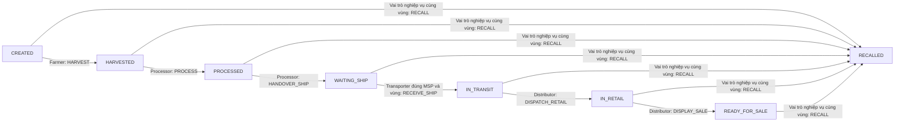

> **Cập nhật 06/11/2026:** xem [kết quả sửa lỗi và triển khai Fabric v2](./REMEDIATION_RESULTS.md) và [API hiện tại](./API_INTEGRATION.md). Nội dung bên dưới là khảo sát/kết quả của đợt trước; các hạn chế signer/Org3/ABI, rollback RAM, recall lặp và API nhật ký đã được xử lý theo báo cáo mới. 13 hash legacy vẫn được giữ nguyên.

# Kế hoạch triển khai Frontend TraceChain

## 1. Khảo sát và phạm vi

Đã đọc FRONTEND_TASK.md, AGENTS.md, toàn bộ source ứng dụng backend/frontend,
chaincode, schema, Docker Compose, script seed/test và README. Không chỉnh Fabric
network, volume, MSP, chaincode hoặc chạy seed/reset trên database đang có.

Backend: Express 5/CommonJS; MySQL 8 qua mysql2, không phải PostgreSQL. `server.js`
chứa route/controller/middleware; `domain.js` thực thi FSM local trong bộ nhớ;
`storage.js` lưu projection off-chain; `fabric.js` dùng gRPC Fabric Gateway.
Không có ORM, migration framework hay OpenAPI. SQL gồm organizations, actors,
actor_roles, user_accounts, lots, trace_events, event_documents, audit_log.

Frontend hiện có React/CRA/JavaScript, Router 6, fetch, 6 màn hình cơ bản.
Nâng cấp cùng thư mục sang Vite/TypeScript, giữ các URL /dashboard, /lots/new,
/lots/:lotId, /admin/users, /trace/:lotId. Dùng Axios/TanStack Query; CSS hiện có
được mở rộng thay vì thêm hệ thống component và dependency trùng chức năng.

## 2. API inventory thực tế trước sửa

| Method   | /api endpoint                             | Quyền       | Contract chính                                                             |
| -------- | ----------------------------------------- | ----------- | -------------------------------------------------------------------------- |
| GET      | /health                                   | Công khai   | status, mysql, fabric (cấu hình, không phải readiness)                     |
| POST     | /auth/login                               | Công khai   | username,password → token,user                                             |
| POST     | /auth/logout                              | Phiên       | 204                                                                        |
| GET/POST | /users                                    | Admin       | User[] / username,password,role,actorId,orgMsp                             |
| PATCH    | /users/:username/status                   | Admin       | status ACTIVE/INACTIVE                                                     |
| POST     | /users/:username/reset-password           | Admin       | password; đồng thời kích hoạt tài khoản                                    |
| GET      | /organizations                            | Công khai   | organizationId,mspId,name,organizationType,address,status                  |
| GET/POST | /actors                                   | Phiên/Admin | Actor[] / actorId,mspId,fabricIdentity,fullName,actorType,roles,regionCode |
| GET      | /admin/audit-log                          | Admin       | tối đa 500 bản ghi                                                         |
| GET      | /lots                                     | Phiên       | Lot[] theo vùng, Admin toàn hệ thống                                       |
| GET      | /lots/:lotId                              | Phiên       | Lot có events; kiểm tra vùng                                               |
| POST     | /lots                                     | Farmer      | lotId,productName,origin,harvestDate,location,regionCode                   |
| POST     | /lots/:lotId/events                       | Vai trò FSM | eventType,location,previousEventId,data                                    |
| POST     | /lots/:lotId/handover/request             | Processor   | location,previousEventId,toOrg,toRegion,data:{toOrg,toRegion}              |
| POST     | /lots/:lotId/handover/confirm             | Transporter | location,previousEventId,data                                              |
| POST     | /lots/:lotId/recall                       | Nghiệp vụ   | location,previousEventId,data                                              |
| GET      | /lots/:lotId/history                      | Phiên       | TraceEvent[]                                                               |
| GET      | /lots/:lotId/validate                     | Phiên       | valid,checkedEvents,brokenLinks,invalidHashes hoặc anomalies               |
| GET      | /lots/:lotId/verify-documents             | Phiên       | valid,documents[]                                                          |
| POST     | /documents                                | Phiên       | multipart document,lotId; tối đa 5 MiB                                     |
| GET      | /lots/:lotId/qr                           | Công khai   | PNG URL trỏ PUBLIC_BASE_URL/trace/:lotId                                   |
| GET      | /public/lots/:lotId; /public/trace/:lotId | Công khai   | sản phẩm,events,integrity                                                  |

## 3. Danh tính và phân quyền

Bearer token ngẫu nhiên, session Map trong RAM, mất khi Backend restart. Mật khẩu
scrypt; user account gắn actor và organization. Role ứng dụng khác MSP. Fabric
hiện dùng **một certificate cấu hình chung**, chưa chọn signer theo tài khoản.
Không tuyên bố hỗ trợ giao dịch đa vai trò Fabric an toàn khi chưa có signer tương ứng.

| Role        | MSP                 | Quyền ghi theo FSM                               |
| ----------- | ------------------- | ------------------------------------------------ |
| FARMER      | Org1MSP             | CREATE, HARVEST, RECALL                          |
| PROCESSOR   | Org1MSP             | PROCESS, HANDOVER_SHIP, RECALL                   |
| TRANSPORTER | Org2MSP             | RECEIVE_SHIP đúng MSP/vùng nhận, RECALL          |
| DISTRIBUTOR | Org3MSP             | DISPATCH_RETAIL, DISPLAY_SALE, RECALL            |
| ADMIN       | Không đồng nhất MSP | giám sát, user/actor, audit; không ghi nghiệp vụ |
| CONSUMER    | Không có            | đọc projection công khai                         |

Source hiện cấp quyền theo role + vùng, không ràng buộc mọi bước theo currentHolder.
FE không tự đặt thêm luật chủ sở hữu vì sẽ chặn Processor/Distributor hợp lệ.

Farmer không có quyền bàn giao trực tiếp. Không có sự kiện nhận tại sơ chế hoặc
bàn giao riêng từ vận chuyển; Distributor xuất điểm bán trực tiếp từ IN_TRANSIT.
Chaincode cho phép RECALL lặp lại; UI khóa thao tác sau thu hồi để tránh gửi trùng.

## 4. Các sửa tích hợp tối thiểu cần có

- GET /auth/me, kiểm tra lại tài khoản đang hoạt động và thu hồi session khi khóa/reset.
- Dùng một hàm kiểm tra phạm vi lô cho detail/history/validate/documents và ghi.
- Dựng pendingTo/pendingToRegion từ sự kiện đã lưu, không thêm migration.
- Khôi phục lot local từ projection trước mutation sau restart; kiểm tra trùng mã
  trong storage trước CREATE để tránh ghi đè lịch sử đã tồn tại.
- Sửa tên Gateway ReadLot/GetLotHistory thành QueryLot/GetHistory đúng chaincode.
- Public projection dùng allowlist, không gửi data/actorId/file path nội bộ.
- Gắn chứng từ ở mọi đường ghi, kiểm tra hash file thực tế khi đối soát.

Callers cần cập nhật: API client, session provider, route guards, form tạo lô,
form event, lot detail, dashboard, public trace, admin users, tests, Dockerfile,
package/lockfile và README. Kiểm thử Backend bằng HTTP với storage được thay thế
trong test, không ghi database. Không đổi luật FSM.

## 5. Trang và giai đoạn

1. Khảo sát: tài liệu này, inventory và đối chiếu PDF nếu trích xuất được.
2. Nền tảng: TS/Vite, Axios, Query, session /me, role guards, sidebar, ErrorBoundary.
3. Nghiệp vụ: dashboard từng role; /lots với tìm kiếm, lọc, phân trang client;
   tạo/chi tiết lô, timeline, upload chứng từ, form theo FSM, handover, recall.
4. Công khai: /trace, /trace/:lotId, QR PNG tải/in; xác minh rõ giới hạn.
5. Admin: dashboard, users, organizations, roles, events, handovers,
   recalls, verification, health/blockchain, audit, báo cáo từ dữ liệu thật.
6. Hoàn thiện: responsive, validation, lỗi, test, typecheck/build, tài liệu chạy.

Dashboard số liệu tính từ API trong phạm vi hiện tại; không hardcode số, không
suy ra TPS hoặc kết quả giao dịch thất bại từ lịch sử thành công. Các trang tổng
hợp sự kiện dùng detail API thật, ghi rõ chi phí N+1 và phạm vi dữ liệu.

## 6. Thiếu Backend và rủi ro

Chưa có nhật ký canh tác/vận chuyển, quality, incident, thay đổi tổ chức/Fabric,
đổi mật khẩu tự phục vụ, RBAC động, hủy/từ chối bàn giao, dữ liệu đo hiệu năng,
transaction status API, pagination server, hay API phân công người nhận riêng.
Đề xuất contract cụ thể ở API_INTEGRATION.md; không tạo màn hình rỗng.

Local mode chỉ là dữ liệu off-chain; HTTP 201 xác nhận Backend ghi nhận, không
phải bằng chứng Blockchain. Fabric submitTransaction đợi commit nhưng hiện signer
chung. Timeout/5xx sau ghi có thể đã commit: không tự retry; bắt buộc tải lại và
đối chiếu lịch sử trước lần gửi tiếp theo. /validate local chỉ kiểm hash/liên kết;
chaincode kiểm FSM và liên kết, không xác minh lại đầy đủ Identity/Event.

Môi trường khảo sát không có API :8080 đang chạy, Docker CLI WSL không hoạt động;
Node/npm có ở host ngoài sandbox. Không được báo kiểm thử Docker/MySQL/Fabric thật
thành công nếu chưa chạy được. PDF sẽ được trích xuất bằng công cụ tạm nếu khả dụng.

## 7. Đối chiếu PDF đã thực hiện

Đã trích xuất báo cáo giữa kỳ (53 trang) và đề cương (21 trang), đối chiếu
chương 2, mục 2.1–2.3, bảng 2.1, mục 2.6/bảng 2.2 và mục 2.7.
Báo cáo mô tả 8 CTE và vòng đời trùng chuỗi chính của source. Tuy nhiên:

- Báo cáo thiết kế PostgreSQL; source/Docker triển khai MySQL. Giữ MySQL.
- Bảng 2.1 cho Farmer và Processor yêu cầu bàn giao; source chỉ Processor và
  chỉ từ PROCESSED. Giữ luật source, không thêm bàn giao Farmer.
- Báo cáo dùng currentHolder ví dụ MSP; source lưu Actor ID/x509 identity.
  UI ghi rõ Actor ID, không biến thành tổ chức mà không có dữ liệu.
- Báo cáo đề xuất kiểm tra IESH đủ bốn nhóm; ValidateTraceHistory hiện chưa
  đánh giá lại đầy đủ Identity/Event. UI công bố đúng phạm vi hiện thực.
- Báo cáo yêu cầu khóa sau thu hồi; chaincode vẫn cho RECALL lặp. FE khóa
  tất cả thao tác sau thu hồi, không sửa luật chaincode.
- Báo cáo mô tả nhật ký/quality/logistics; chưa có API riêng, không tự tạo CTE.

PDF được đọc bằng pdfjs-dist trong thư mục công cụ tạm; không thêm dependency
PDF vào ứng dụng.

## 8. Cập nhật yêu cầu MySQL

MySQL thay thế mọi đề xuất PostgreSQL trong tài liệu nghiệp vụ. Backend đã dùng
MySQL nên không chuyển database. Docker/MySQL đã hoạt động, đã khảo sát dữ liệu,
backup và triển khai bản tương thích; chi tiết ở [MYSQL_VERIFICATION](./MYSQL_VERIFICATION.md).
Không có migration schema/data trên database active. Mọi kiểm thử ghi chạy
trong database tạm riêng; mọi kiểm tra API trên dữ liệu active chỉ đọc.
